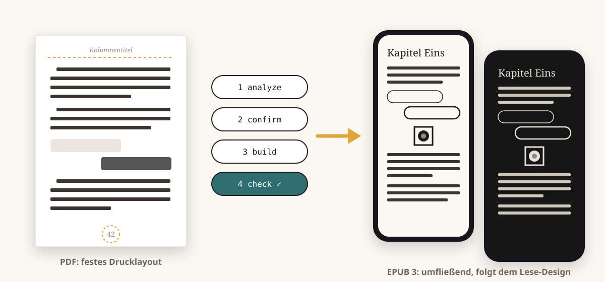
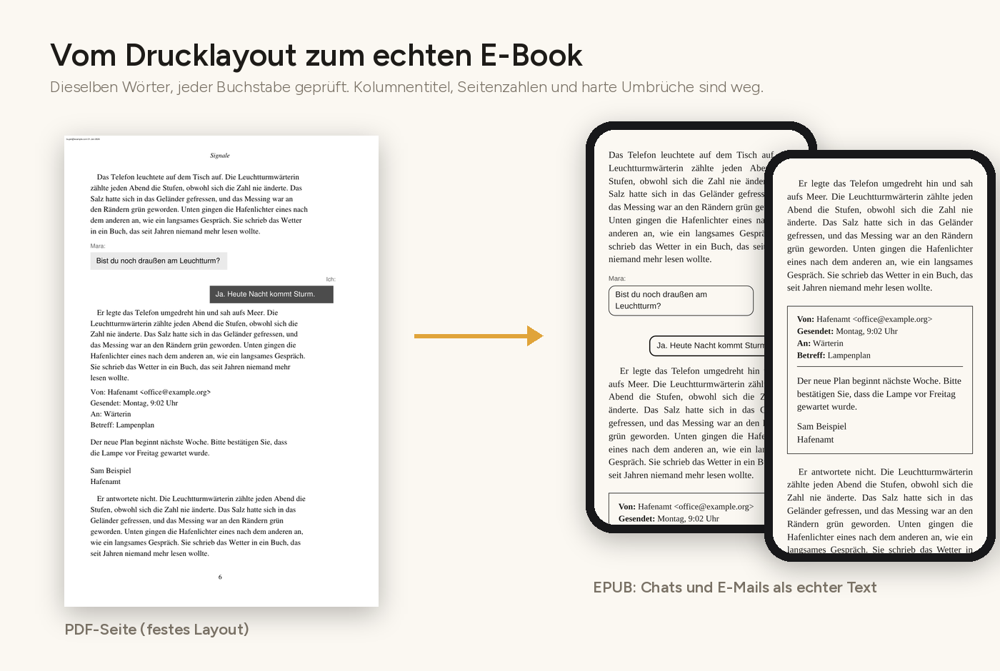
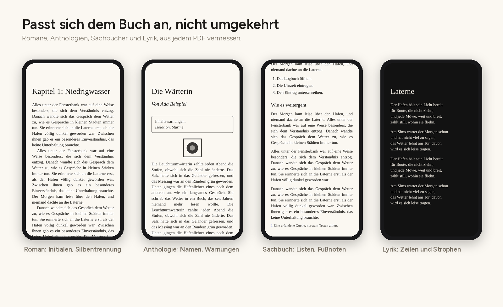
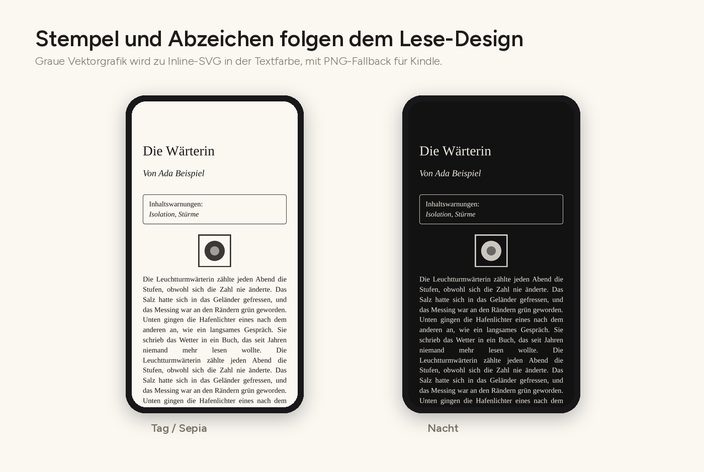
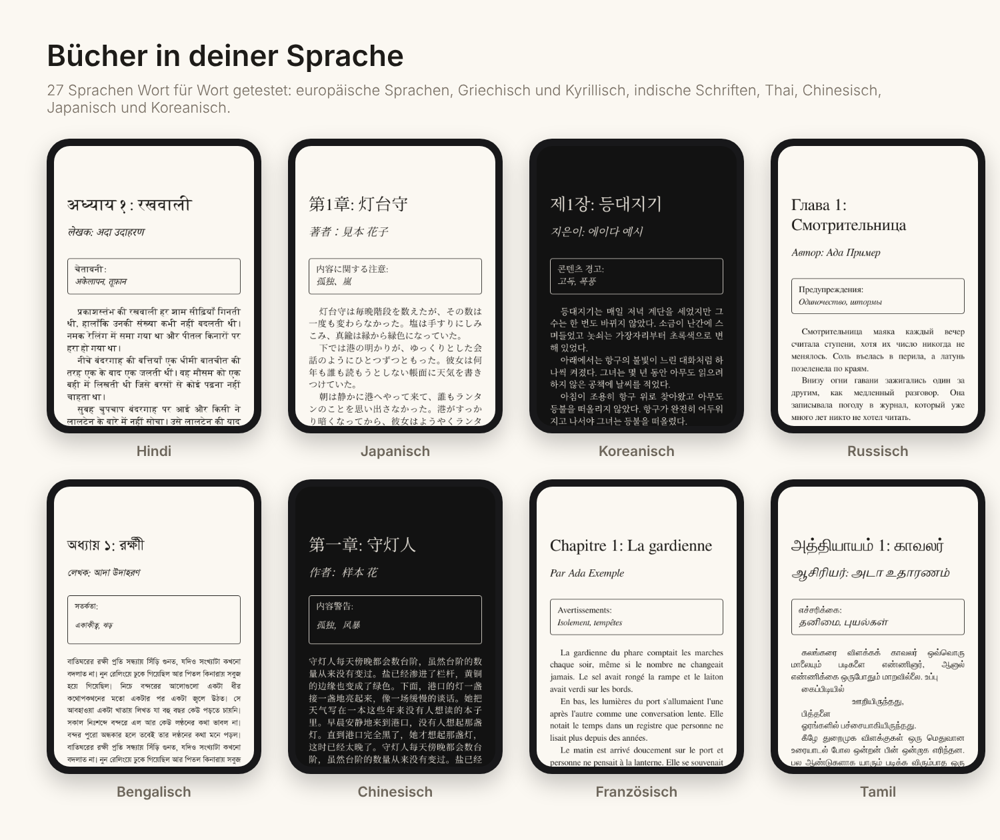
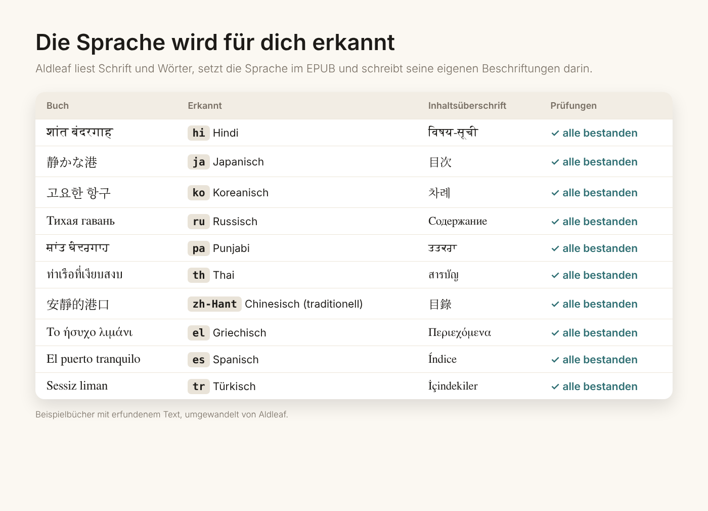
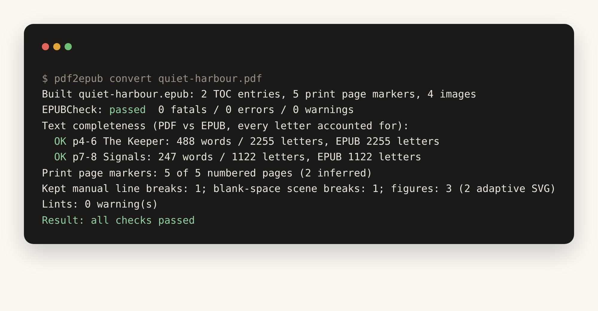

<p align="center"><picture><source media="(prefers-color-scheme: dark)" srcset="site/assets/logo-dark.svg"></picture></p>
<h1 align="center">Aldleaf</h1>
<p align="center"><a href="README.md">English</a> · <b>Deutsch</b></p>
<p align="center"><b>Jedes gedruckte Blatt, neu geschrieben als EPUB.</b><br>Ein kostenloser Open-Source-Konverter von PDF zu EPUB (pdf2epub) für Selfpublisher: textbasierte PDF-Bücher → sauberes, geprüftes, barrierearmes EPUB 3.</p>
<p align="center">
  <a href="https://github.com/5aahil/aldleaf-pdf2epub/actions/workflows/ci.yml"></a>
  
  
  
  <a href="https://www.realgoodai.org/real-rating"></a>
</p>
<p align="center"><a href="https://www.realgoodai.org/real-rating"></a></p>
<p align="center"><a href="https://5aahil.github.io/aldleaf-pdf2epub/de/">Projektseite</a> · <a href="docs/config.md">Konfigurationsreferenz (Englisch)</a> · <a href="docs/languages.md">Sprachen (Englisch)</a> · <a href="PRIVACY.md">Datenschutzerklärung (Englisch)</a> · <a href="docs/privacy.md">Datenschutzregeln (Englisch)</a></p>

<p align="center"></p>

Mach aus einem **textbasierten PDF-Buch** ein sauberes, geprüftes, barrierearmes **EPUB 3**, bereit zur Veröffentlichung, wo immer du willst.

> **Starte mit einem PDF.** Aldleaf liest vorerst **nur PDF-Dateien**. Liegt dein Buch in Word, Pages, Google Docs, Scrivener oder einem anderen Programm vor, exportiere zuerst deine **fertige, lektorierte, druckreife Fassung als PDF** (zum Beispiel Datei → Speichern unter → PDF) und wandle dann dieses PDF um.

## Zum Namen

*Aldleaf* (gesprochen „ALD-lief“; früher **pdf2epub-kit**) ist nach dem **aldinischen Blatt ❦** benannt, dem Blattornament des Renaissance-Druckers Aldus Manutius, auf den das Taschenbuch und die Kursivschrift zurückgehen. Drucker markierten damit einen neuen Abschnitt, ähnlich wie die Szenenwechsel, die Aldleaf aus deiner Druckausgabe übernimmt. Das Blatt im Logo ist das ❦ aus [Noto Sans Symbols 2](https://github.com/notofonts/symbols) (SIL Open Font License 1.1).

## Für wen

**Autorinnen, Autoren und Verlage im Selfpublishing**, die ein druckreifes PDF haben, aber noch kein richtiges E-Book:

- **Selfpublisher:** Du hast dein Buch für den Druck gesetzt (InDesign, Affinity, Word, Vellum, Scribus, LaTeX) und willst ein E-Book, ohne für die Umwandlung zu bezahlen oder alles neu abzutippen.
- **Kleine und unabhängige Verlage:** Mach aus Backlist und neuen Druckdateien einheitliche, barrierearme EPUBs.
- **Anthologien, Magazine und Wettbewerbe:** Sammelbände mit vielen Autorinnen und Autoren, Namenszeilen, Widmungen und Inhaltswarnungen.
- **Lektorat und Buchgestaltung:** wenn du Druck- und E-Book-Dateien übergibst.

**Veröffentliche auf jeder Plattform.** Das Ergebnis ist ein standardkonformes, geprüftes EPUB 3, das Format, das die großen Shops und Distributoren annehmen: Amazon KDP, Apple Books, Tolino Media, Kobo Writing Life, Google Play Books, Distributoren wie BoD oder Draft2Digital, oder der Direktverkauf über deine eigene Website. Prüfe vor dem Veröffentlichen die aktuellen Upload-Vorgaben des jeweiligen Shops.

**Leserinnen und Leser** können es auch für ihr eigenes DRM-freies Exemplar eines Buchs auf ihren eigenen Geräten nutzen.

Es ist **nicht** dafür gedacht, Bücher umzuwandeln oder weiterzugeben, an denen du keine Rechte hast. Kopiergeschützte PDFs werden abgelehnt.

Ein-Klick-Konverter machen aus einem PDF einfach Textzeilen. Aldleaf **liest stattdessen das Layout**:

- **Schriften, Größen und Positionen:** Es erkennt, wofür jede Schrift verwendet wird (Fließtext, Überschriften, Chatnachrichten, E-Mails, Bildschirmtext, Fußnoten, Bildunterschriften).
- **Buchstruktur:** Es findet, wo Kapitel beginnen, und liest die gedruckten Seitenzahlen.
- **Einstellungsdatei:** Es schreibt all das in eine Einstellungsdatei (die Buchkonfiguration), die du prüfst, bevor etwas erstellt wird.
- **Selbstprüfung:** Nach dem Erstellen prüft es seine eigene Arbeit.

```
aldleaf analyze book.pdf      # propose a book config (book.aldleaf.yaml)
                               # -> review / edit the config
aldleaf build book.pdf        # build book.epub and check it
```

oder in einem Schritt: `aldleaf convert book.pdf`.



## Was es kann

| Bereich | Was Aldleaf macht |
|---|---|
| **Bucharten** | Romane, Anthologien (Namenszeilen, Widmungen und Inhaltswarnungen pro Geschichte), Sachbücher (Zwischenüberschriften, Aufzählungen und nummerierte Listen, Fußnoten → Pop-up-Anmerkungen), Lyrik (Zeilenumbrüche und Strophen bleiben erhalten) |
| **Satz** | Erstzeileneinzug, Absätze mit Abstand oder beides; Blocksatz oder Flattersatz; Initialen; automatische Silbentrennung (entfernt) und echte Bindestriche (erhalten); über Seiten getrennte Absätze; versehentliche Absatzwechsel mitten im Satz |
| **Kolumnentitel und Seitenzahlen** | werden anhand der Position aus dem Text entfernt, nicht anhand der Schriftgröße; jede Druckseite bekommt eine Marke, auch unnummerierte Kapitelanfänge. Dank der Seitenliste zeigt Apple Books die gedruckten Seitenzahlen. |
| **Sonderlayouts** | Handy-Chats (Sprechblasen links und rechts mit Absendernamen), E-Mails (Blöcke mit Von/Gesendet/An/Betreff, Signaturen bleiben erhalten), Bildschirm- und KI-Text (Festbreitenschrift), zweispaltige Namenslisten |
| **Szenenwechsel** | bleiben genau so, wie der Autor sie gesetzt hat: das eigene gedruckte Zeichen (`* * *`, `❧`, …) oder eine Leerzeile. Die Buchart ändert daran nichts. Mit `scene_breaks: ornament` gibt es überall dasselbe Ornament. |
| **Sprachen** | Bücher in jeder waagerecht von links nach rechts geschriebenen Sprache: lateinische, griechische und kyrillische Schrift, Hindi, Marathi, Punjabi, Bengalisch, Tamil und weitere indische Schriften, Thai, Chinesisch (vereinfacht und traditionell), Japanisch und Koreanisch. Die Sprache des Buchs wird erkannt und im EPUB gesetzt; Kapitelbezeichnungen, Namenszeilen und Inhaltswarnungen werden in jeder Sprache erkannt; Aldleafs eigene Beschriftungen folgen der Sprache des Buchs; eine beschädigte Textebene im PDF wird, wo es sicher ist, repariert und sonst gemeldet. 27 Sprachen Wort für Wort getestet: siehe [docs/languages.md](docs/languages.md) (Englisch). |
| **Grafiken** | Rasterbilder bleiben Bilder; graue Vektor-Abzeichen, Stempel und Logos werden zu adaptiven SVGs, die hellem und dunklem Design folgen (PNG-Fallback für Kindle); Größe wie im Druck |
| **Paket** | EPUB 3 mit EPUB-2-NCX-Fallback, Landmarks, Seitenliste, Cover, Metadaten (Titel, Autoren, Mitwirkende, Verlag, ISBN), schema.org-Metadaten zur Barrierefreiheit, optional eingebettete Schriften mit der Apple-Books-Option „Original“ |



### Adaptive Grafiken

- **Graue Vektorgrafiken** (Bewertungsstempel, Abzeichen, Logos, Ornamente) werden zu **Inline-SVGs in der Textfarbe des Readers**. Sie sind in jeder Größe scharf, haben keinen weißen Kasten und werden im Nachtmodus hell. Kindle erhält ein transparentes PNG als Fallback, und die Datei ist im Paket mit `properties="svg"` gekennzeichnet.
- **Farbige Grafiken und Fotos** bleiben Bilder.
- Mit `art: png` bleiben alle Grafiken Bilder.



**Nicht unterstützt:**
- Word (.docx), Pages, Google Docs und andere Programmdateien: Exportiere zuerst deine fertige, druckreife Fassung als PDF.
- Gescannte PDFs (ohne Textebene): Sie werden erkannt und abgelehnt.
- Komplexe Lehrbuchlayouts (mehrspaltiger Fließtext, große Tabellen, Formeln).
- Bücher in Schriften von rechts nach links (Arabisch, Hebräisch, Persisch, Urdu) und senkrechter chinesischer oder japanischer Text: werden erkannt und mit einer klaren Meldung abgelehnt (beides [als Nächstes geplant](#als-nächstes-geplant)).
- Kopiergeschützte PDFs: Sie werden abgelehnt (siehe [Rechte](#rechte-und-datenschutz)).

## Sprachen

Aldleaf wandelt Bücher in jeder Sprache um, die waagerecht von links nach rechts geschrieben wird. Es übersetzt deinen Text nie.



- **Die Sprache wird für dich erkannt,** aus dem PDF, der Schrift und den Wörtern, und im EPUB gesetzt, damit Reader, Shops und Screenreader die richtigen Schriften, die richtige Silbentrennung und Aussprache wählen. Die Zusammenfassung von `analyze` sagt, wie sie gefunden wurde; du kannst sie jederzeit in der Konfiguration festlegen.
- **Layoutwörter werden in jeder Sprache erkannt:** Kapitelbezeichnungen („Kapitel 3“, „第1章“, „अध्याय १“), Namenszeilen („Par …“, „लेखक: …“), Inhaltswarnungen, E-Mail-Köpfe und Abschnittstitel.
- **Aldleafs eigene Beschriftungen folgen dem Buch:** die Inhaltsüberschrift, die Namen von Cover und Titelseite und die Seitenzahlen, die Screenreader ansagen.
- **Schriften ohne Leerzeichen** (Chinesisch, Japanisch, Thai) werden ohne zusätzliche Leerzeichen verbunden; koreanische Wörter, die über zwei Zeilen getrennt sind, werden wieder zusammengefügt.
- **Die versteckte Textebene des PDFs wird geprüft:** doppelte Zeichen in indischen Schriften werden repariert, beschädigte Wörter gemeldet, und der Build meldet bei einem beschädigten PDF keinen Erfolg.



27 Sprachen wurden mit erfundenen Beispielbüchern Wort für Wort getestet, jeweils als Anthologie, Roman, Sachbuch und Lyrik. Die vollständige Liste und was du bei Thai prüfen solltest, steht in [docs/languages.md](docs/languages.md) (Englisch).

### Als Nächstes geplant

- **Bücher von rechts nach links:** Urdu, Arabisch, Persisch und Hebräisch. Heute werden sie erkannt und abgelehnt.
- **Senkrechter chinesischer und japanischer Text.** Heute wird er erkannt und abgelehnt.
- **Bücher in mehr als einer Sprache:** zweisprachige Ausgaben, Übersetzungen neben dem Original, Passagen einer Autorin oder eines Autors in einer anderen Sprache oder eine Nacherzählung einer Mythologie, die die Originalverse zitiert. Jede Passage behält dann ihre eigene Sprachkennzeichnung.

## Installation

```
pip install git+https://github.com/5aahil/aldleaf-pdf2epub
# optional: validation and visual reports
aldleaf fetch-epubcheck          # needs Java to run
pip install "aldleaf[visual] @ git+https://github.com/5aahil/aldleaf-pdf2epub" && playwright install chromium
```

Python 3.10+. Abhängigkeiten: PyMuPDF, PyYAML.

## Der Ablauf



1. **Analysieren.** `aldleaf analyze book.pdf` gibt eine Zusammenfassung aus und schreibt `book.aldleaf.yaml`:
   - **Metadaten:** Titel, Autoren, Verlag, Jahr und ISBN, gelesen aus Titel- und Impressumsseite, dazu die Sprache des Buchs.
   - **Profil:** Buchart, Absatzstil, Ausrichtung und Silbentrennung.
   - **Geometrie:** Zeilenabstand, Absatzabstand, Einzug und Satzbreite, alles aus dem PDF gemessen.
   - **Stile:** jede Schrift@Größe mit vermuteter Rolle und einer kurzen Probe.
   - **Abschnitte:** Titelseite, Impressum, Inhaltsverzeichnis (als Links neu aufgebaut), Kapitel mit Autoren, Vor- und Nachspann.
2. **Bestätigen.** Korrigiere, was falsch erkannt wurde: eine Rolle, einen Abschnittstitel, einen Autor, die Sprache (die Zusammenfassung zeigt, ob sie erkannt wurde). Siehe [docs/config.md](docs/config.md) (Englisch).
3. **Erstellen.** `aldleaf build book.pdf` schreibt `book.epub`, `book_QA.txt` und `book.build.json`.
4. **Prüfen.** Beim Erstellen laufen die Prüfungen automatisch:
   - EPUBCheck, falls installiert.
   - Vollständigkeit: Jeder Buchstabe jedes Abschnitts wird mit dem PDF verglichen.
   - Abdeckung der Seitenmarken.
   - Lints für typische Umwandlungsfehler: übrig gebliebene Seitenzahlen, nicht verbundene Zeilenumbrüche, fehlende Absatzwechsel.

   Optional:
   - `--visual DIR` schreibt PDF- und EPUB-Screenshots zum direkten Vergleich.
   - `--reference other.epub` vergleicht die Struktur mit einer handgemachten Ausgabe: Abschnitte, Chats, E-Mails, Szenenwechsel, Seitenmarken.
5. **Auf Geräten testen.** Öffne das EPUB in Apple Books und schicke es mit Send to Kindle auf einen Kindle. Sieh dir ein Kapitel im hellen und im dunklen Design an.

## Rechte und Datenschutz

- **Keine Datenerhebung:** Aldleaf hat keine Konten, keine Analyse und keinen Server. Deine Dateien bleiben auf deinem Computer. Siehe die [Datenschutzerklärung](PRIVACY.md) (Englisch).
- Nutze Aldleaf für Bücher, die du geschrieben hast oder verlegst, oder für dein eigenes Exemplar auf deinen eigenen Geräten. Gib keine EPUBs von Büchern anderer weiter.
- **Kopierschutz:** Verschlüsselte oder passwortgeschützte PDFs werden abgelehnt. Aldleaf entfernt niemals einen Kopierschutz.
- **Käuferstempel:** Viele Shop-PDFs tragen die E-Mail-Adresse des Käufers auf jeder Seite. Aldleaf erkennt den Stempel und lässt ihn weg. Mit `--stamp` fügt es stattdessen eine Zeile „Lizenziert für …“ ins Impressum ein. So oder so enthalten PDF und EPUB personenbezogene Daten: Lade sie nie in ein Repository hoch. Siehe [docs/privacy.md](docs/privacy.md) (Englisch).

## Mit Claude nutzen

Der passende Claude-Skill **aldleaf** (Kurznamen: **pdf2epub** und **pdf-to-epub**) steuert dieses Toolkit:

1. Er führt `analyze` aus.
2. Er geht die vorgeschlagene Konfiguration mit dir durch und prüft Seiten gegen das PDF.
3. Er erstellt und prüft das EPUB und vergleicht gerenderte Seiten mit dem PDF.
4. Er übergibt dir das EPUB und einen Prüfbericht.

Der Skill liegt in diesem Repository unter [`plugin/skills/aldleaf/SKILL.md`](plugin/skills/aldleaf/SKILL.md).

**Skill installieren**

- **Claude Code:**
  ```
  /plugin marketplace add 5aahil/aldleaf-pdf2epub
  /plugin install aldleaf@aldleaf
  ```
  Bitte Claude dann, ein PDF umzuwandeln, oder führe `/aldleaf:aldleaf` oder die Kurzbefehle `/aldleaf:pdf2epub` und `/aldleaf:pdf-to-epub` aus.
- **Claude-App (Web, Desktop):** Lade [aldleaf-skill.zip](https://5aahil.github.io/aldleaf-pdf2epub/aldleaf-skill.zip) herunter, gehe zu **Customize → Skills → + → Upload a skill** und wähle die ZIP-Datei. Die Codeausführung muss in deinen Einstellungen aktiviert sein.

## Community

- [Mitwirken](CONTRIBUTING.md) · [Verhaltenskodex](CODE_OF_CONDUCT.md) · [Sicherheitsrichtlinie](SECURITY.md) · [Barrierefreiheit](ACCESSIBILITY.md) (alle auf Englisch)
- Fehler und Ideen: Nutze die [Issue-Formulare](https://github.com/5aahil/aldleaf-pdf2epub/issues/new/choose). Hänge nie echte Bücher oder personenbezogene Daten an.

## Entwicklung

```
pip install -e ".[dev]"
pytest
```

Die Tests erzeugen synthetische Bücher verschiedener Arten (Anthologie, Roman, Sachbuch, Lyrik); jedes Wort darin ist erfundener Fülltext. Lade nie echte Bücher, echte PDFs oder echte EPUBs ins Repository hoch.

MIT-Lizenz.

## Projektseite

Die Website in [`site/`](site) wird über `.github/workflows/pages.yml` auf GitHub Pages veröffentlicht, auf Englisch und auf Deutsch (`site/de/`). Zum Einschalten gehe zu **Settings → Pages → Source** und wähle **GitHub Actions**. Alle Beispielbilder stammen aus den synthetischen Testbüchern, jedes Wort darin ist also erfunden.

## KI-Offenlegung

**REAL Rating 3 (moderate KI)**, selbst eingestuft auf der [REAL-Rating](https://www.realgoodai.org/real-rating)-Skala von Real Good AI. KI hat unter Leitung des Autors Bausteine beigetragen (Code, Dokumentation und Illustrationen). Der Autor hat die Anforderungen und das Design festgelegt, das Toolkit an echten Büchern getestet, Fehler gemeldet und die Korrekturen geprüft und alle Entscheidungen getroffen.
