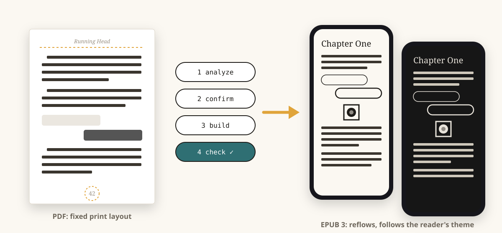
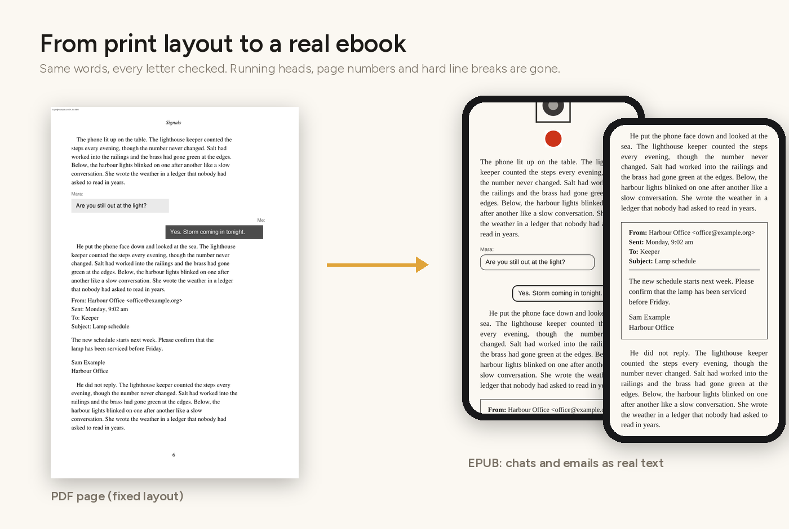
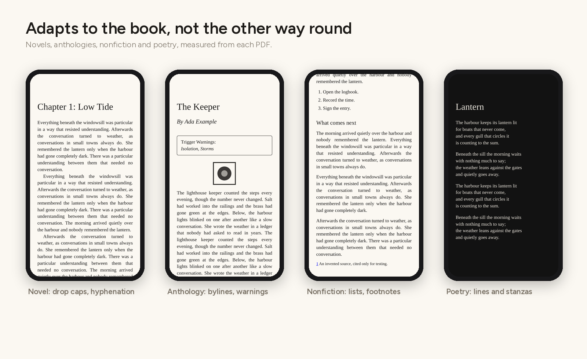
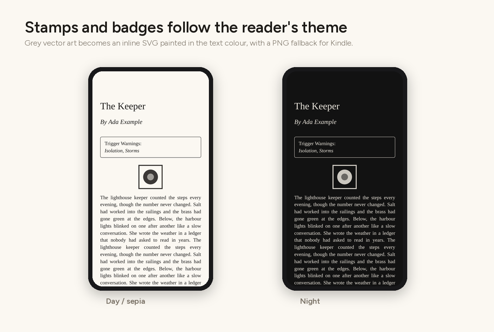
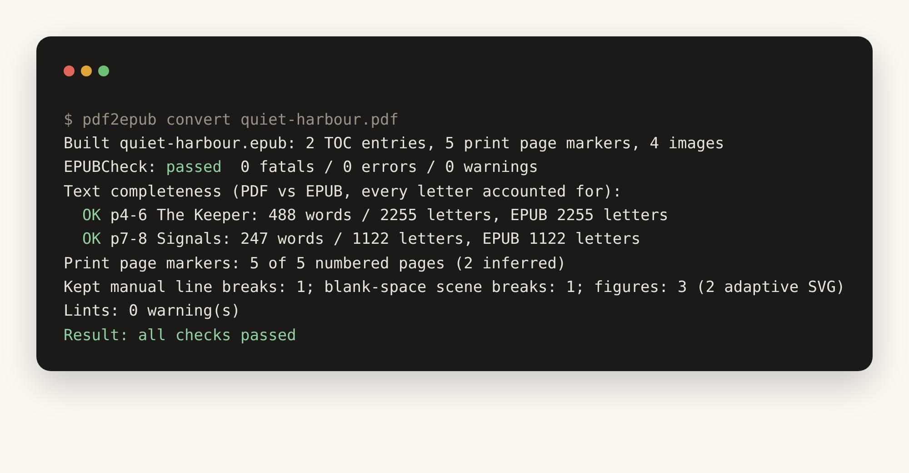

<p align="center">&nbsp;&nbsp;&nbsp;<a href="https://www.realgoodai.org/real-rating"></a></p>
<h1 align="center">pdf2epub-kit</h1>
<p align="center"><b>Text-based PDF books → clean, validated, accessible EPUB 3 for Apple Books and Kindle.</b></p>
<p align="center">
  <a href="https://github.com/5aahil/pdf2epub-kit/actions/workflows/ci.yml"></a>
  
  
  
  <a href="https://www.realgoodai.org/real-rating"></a>
</p>
<p align="center"><a href="https://5aahil.github.io/pdf2epub-kit/">Project page</a> · <a href="docs/config.md">Config reference</a> · <a href="docs/privacy.md">Privacy rules</a></p>

<p align="center"></p>

Turn a **text-based PDF book** into a clean, validated, accessible **EPUB 3**, ready to publish wherever you choose.

## Who it's for

**Authors, writers and publishers who self-publish**, and who have a print-ready PDF but no proper ebook:

- **Self-publishing authors and writers:** you laid out your book for print (InDesign, Affinity, Word, Vellum, Scribus, LaTeX) and want an ebook without paying for a conversion or retyping it.
- **Small and independent publishers and presses:** turn your back catalogue and new print files into consistent, accessible EPUBs.
- **Anthology, magazine and competition organisers:** collections with many authors, bylines, dedications and content warnings.
- **Editors and book designers** who hand over both print and ebook files.

**Publish on any platform you want.** The output is a standard, validated EPUB 3, the format the main ebook stores and distributors accept: Amazon KDP, Apple Books, Kobo Writing Life, Google Play Books, Barnes & Noble Press, aggregators such as Draft2Digital, or direct sales from your own website or shop. Check each store's current upload requirements before you publish.

**Readers** can also use it on their own DRM-free copy of a book, for their own devices.

It is **not** for converting or sharing books you don't have the rights to. Copy-protected PDFs are refused.

One-click converters flatten a PDF into lines of text. pdf2epub instead **reads the layout**:

- **Fonts, sizes and positions:** it works out what each font is used for (body text, headings, chat messages, emails, on-screen text, footnotes, captions).
- **Book structure:** it finds where chapters start and reads the printed page numbers.
- **Settings file:** it writes all of that into a settings file (the book config) that you check before anything is built.
- **Self-check:** after the build it checks its own work.

```
pdf2epub analyze book.pdf      # propose a book config (book.pdf2epub.yaml)
                               # -> review / edit the config
pdf2epub build book.pdf        # build book.epub and check it
```

or in one go: `pdf2epub convert book.pdf`.



## What it handles

| | |
|---|---|
| **Book kinds** | novels, anthologies (per-story bylines, dedications, content warnings), nonfiction (subheadings, bullet/numbered lists, footnotes → pop-up notes), poetry (line breaks and stanzas kept) |
| **Typesetting** | first-line indents, spaced paragraphs or both; justified or ragged-right; drop caps; automatic hyphenation (removed) vs real compounds (kept); paragraphs split across pages; stray mid-sentence paragraph returns |
| **Running heads & page numbers** | removed from the text by position, not font size; every print page gets a marker, including unnumbered chapter openers. The page list lets Apple Books show the print page numbers. |
| **Special layouts** | phone chats (left/right bubbles with sender labels), emails (From/Sent/To/Subject blocks, signatures kept), on-screen/AI text (monospace), two-column name lists |
| **Scene breaks** | kept exactly as the author set them: their own printed marker (`* * *`, `❧`, …) or blank space. Book kind never changes them. Set `scene_breaks: ornament` if you want one uniform rule everywhere. |
| **Art** | raster images as pictures; grey vector badges, stamps and logos as adaptive SVG that follows light/dark themes (PNG fallback for Kindle); sized like the print |
| **Package** | EPUB 3 + EPUB 2 NCX fallback, landmarks, page list, cover, metadata (title, authors, contributors, publisher, ISBN), schema.org accessibility metadata, optional embedded fonts with the Apple Books "Original" font option |



### Adaptive artwork

- **Grey vector art** (rating stamps, badges, logos, ornaments) becomes an **inline SVG painted in the reader's text colour**. It's sharp at any size, has no white box, and turns light in night mode. Kindle gets a transparent PNG fallback, and the file is flagged `properties="svg"` in the package.
- **Colour art and photos** stay pictures.
- To keep every piece of art as a picture, set `art: png`.



**Not supported:**
- Scanned PDFs (no text layer): these are detected and refused.
- Complex textbook layouts (multi-column body text, big tables, maths).
- Copy-protected PDFs: these are refused (see [Rights](#rights-and-privacy)).

## Install

```
pip install git+https://github.com/5aahil/pdf2epub-kit
# optional: validation and visual reports
pdf2epub fetch-epubcheck          # needs Java to run
pip install "pdf2epub-kit[visual] @ git+https://github.com/5aahil/pdf2epub-kit" && playwright install chromium
```

Python 3.10+. Dependencies: PyMuPDF, PyYAML.

## The workflow




1. **Analyse.** `pdf2epub analyze book.pdf` prints a summary and writes `book.pdf2epub.yaml`:
   - **metadata:** title, authors, publisher, year and ISBN, read from the title and copyright pages.
   - **profile:** book kind, paragraph style, alignment and hyphenation.
   - **geometry:** leading, paragraph gap, indent and text width, all measured from the PDF.
   - **styles:** every font@size with a guessed role and a short sample.
   - **sections:** title page, copyright, contents (rebuilt as links), chapters with authors, front and back matter.
2. **Confirm.** Fix anything the guesses got wrong: a role, a section title, an author, the language. See [docs/config.md](docs/config.md).
3. **Build.** `pdf2epub build book.pdf` writes `book.epub`, `book_QA.txt` and `book.build.json`.
4. **Check.** The build runs the checks automatically:
   - EPUBCheck, if installed.
   - Text completeness: every letter of every section is compared with the PDF.
   - Page-marker coverage.
   - Lints for typical conversion mistakes: leftover page numbers, unjoined line wraps, missed paragraph breaks.

   Optional extras:
   - `--visual DIR` writes side-by-side PDF/EPUB screenshots.
   - `--reference other.epub` compares structure with a hand-made edition: sections, chats, emails, scene breaks, page markers.
5. **Test on devices.** Open the EPUB in Apple Books, and send it to a Kindle with Send to Kindle. Look at one chapter in a light and a dark theme.

## Rights and privacy

- Use pdf2epub on books you wrote or publish, or on your own copy of a book for your own devices. Don't share EPUBs of other people's books.
- **Copy protection:** encrypted or password-protected PDFs are refused. pdf2epub never removes copy protection.
- **Buyer stamps:** many shop PDFs stamp the buyer's email on every page. pdf2epub detects the stamp and leaves it out. With `--stamp` it adds one "Licensed to …" line to the copyright page instead. Either way, the PDF and the EPUB contain personal data: never commit them. See [docs/privacy.md](docs/privacy.md).

## Using it with Claude

The companion Claude skill **pdf-to-epub** drives this toolkit:

1. It runs `analyze`.
2. It reviews the proposed config with you, checking pages against the PDF.
3. It builds and checks the EPUB, comparing rendered pages with the PDF.
4. It hands you the EPUB and a QA report.

## Community

- [Contributing](CONTRIBUTING.md) · [Code of conduct](CODE_OF_CONDUCT.md) · [Security policy](SECURITY.md) · [Accessibility](ACCESSIBILITY.md)
- Bugs and ideas: use the [issue forms](https://github.com/5aahil/pdf2epub-kit/issues/new/choose). Never attach real books or personal data.

## Development

```
pip install -e ".[dev]"
pytest
```

The tests generate synthetic books in several kinds (anthology, novel, nonfiction, poetry); every word in them is invented filler. Never add real books, real PDFs or real EPUBs to the repository.

MIT licence.

## Project page

The site in [`site/`](site) deploys to GitHub Pages through `.github/workflows/pages.yml`. To switch it on, go to **Settings → Pages → Source** and choose **GitHub Actions**. All sample images come from the synthetic test books, so every word in them is invented.

## AI disclosure

**REAL Rating 3 (Moderate AI)**, self-assessed on [Real Good AI's REAL Rating](https://www.realgoodai.org/real-rating) scale. AI tools generated building-block components (code, documentation and illustrations) under the author's direction. The author defined the requirements and design, tested the toolkit against real books, reported and checked the fixes, and made the final decisions.
